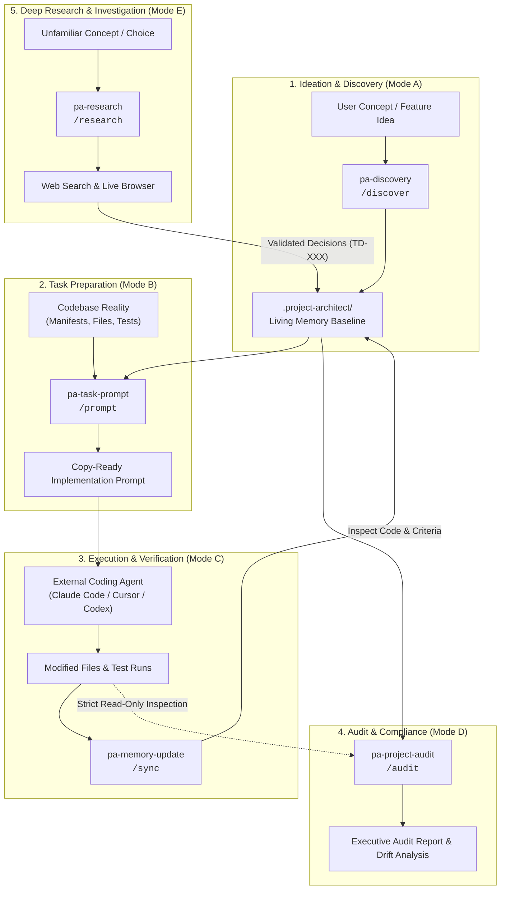

<div align="center">

# Project Architect

**The living architectural companion for AI-assisted software development.**

Stop re-explaining your stack, conventions, and requirements to AI coding agents on every prompt.

[](https://github.com/youngcrypton/project-architect)
[](./docs/REPOSITORY_SETUP.md)
[](https://github.com/youngcrypton/project-architect/releases)
[](#the-living-memory-system)
[](#)

[Quickstart](#quickstart--installation) • [Architecture](#system-architecture--lifecycle) • [Skills & Commands](#skills--activation-commands) • [Living Memory](#the-living-memory-system) • [Documentation](#documentation)

</div>

---

## Why Project Architect?

Autonomous coding agents (Claude Code, Cursor Composer, Codex) excel at executing concrete tasks, but suffer from **context amnesia**. Every new turn requires re-explaining architectural boundaries, approved libraries, user workflows, and previously made trade-offs.

When context is lost, agents hallucinate non-existent imports, invent fictitious file structures, or prematurely claim a feature works without running tests.

**Project Architect is an architectural copilot that sits above the coding agent.** It maintains permanent, portable project memory in your repository, inspects actual code before drafting implementation prompts, tracks development state, and audits the codebase against requirements.

### Comparison: With vs. Without Project Architect

| Development Dimension | Without Project Architect | With Project Architect |
|---|---|---|
| **Context Retention** | Lost across sessions; repeated prompting needed | Persists in local, version-controlled `.project-architect/` files |
| **Idea-Stage Planning** | Coding agents start writing code prematurely | Structured discovery clarifies users, workflows, and constraints first |
| **Prompt Accuracy** | Hallucinates file paths, APIs, and dependencies | Mandatory codebase inspection grounds every prompt in code reality |
| **Completion Claims** | Agent says *"I'm done"*; developer must verify manually | Strict status discipline: `IMPLEMENTED` ≠ `VERIFIED` |
| **Architectural Drift** | Unapproved libraries and patterns slip into the repo | Read-only audits catch divergence between spec and implementation |
| **Privacy & Storage** | Cloud vector stores, paid APIs, telemetry | 100% local Markdown; zero external database dependencies |

---

> [!IMPORTANT]
> ### The Cardinal Rule: `IMPLEMENTED` ≠ `VERIFIED`
> When a coding agent reports that a task or feature is complete, Project Architect marks its status as **`IMPLEMENTED`** (reported, unverified).
> 
> A task is promoted to **`VERIFIED`** only after inspecting the modified source files, reviewing automated test results, and validating each acceptance criterion against tangible evidence.

> [!TIP]
> ### Pre-Execution Confirmation & Alignment Gates
> Project Architect never makes assumptions on ambiguous technical trade-offs or unverified scope. Before generating an implementation prompt, modifying project memory, running an audit, or finalizing a technical decision, it pauses and presents 1–2 focused confirmation questions via interactive buttons, ensuring you always retain architectural control.

---

## System Architecture & Lifecycle

Project Architect orchestrates development across four distinct operating modes:



---

## Skills & Activation Commands

Each capability is encapsulated as an Antigravity skill, triggerable via dedicated slash commands, short aliases, or `@` mentions:

| Skill | Canonical Command | Fast Shortcuts | `@` Mention | Primary Role |
|---|---|---|---|---|
| **`pa-discovery`** | `/pa-discovery` | `/discover`, `/onboard` | `@discovery` | Guided idea discovery and codebase onboarding |
| **`pa-task-prompt`** | `/pa-task-prompt` | `/prompt`, `/task` | `@prompt` | Reality-grounded implementation prompt generator |
| **`pa-memory-update`** | `/pa-memory-update` | `/sync`, `/verify` | `@sync` | Lifecycle tracking, verification, and log updates |
| **`pa-project-audit`** | `/pa-project-audit` | `/audit` | `@audit` | Read-only compliance check and drift detection |
| **`pa-research`** | `/pa-research` | `/research`, `/investigate` | `@research` | Deep technical research via web search & live Chrome browser |

---

### 1. `pa-discovery` — Idea-Stage Onboarding (`/discover`)
- **When to use**: You have a concept but no code, or you want to onboard an existing repository into structured memory.
- **How it works**: Asks one focused question at a time using multiple-choice prompts where appropriate. Distinguishes confirmed user statements (`CONFIRMED`) from assumptions (`PROPOSED`). Never forces premature tech stack decisions.
- **Example**:
  ```text
  User: /discover I want to build a self-hosted uptime monitor for webhooks.
  Agent: [Asks Q1 on target users, Q2 on alert channels, populates .project-architect/]
  ```

### 2. `pa-task-prompt` — Context-Aware Prompt Engine (`/prompt`)
- **When to use**: Preparing an actionable task for Claude Code, Cursor, Codex, or a subagent.
- **How it works**: Reads `.project-architect/` requirements, inspects actual repository manifests (`package.json`, `Cargo.toml`, etc.), resolves discrepancies, and outputs a self-contained 10-point implementation prompt with strict in-scope/out-of-scope boundaries.
- **Example**:
  ```text
  User: /prompt Prepare the task for webhook retry logic with exponential backoff.
  Agent: [Inspects retry handler files, checks test suite, logs TASK-003, outputs copy-ready prompt]
  ```

### 3. `pa-memory-update` — Autonomous Sync & Verification (`/sync`)
- **When to use**: Automatically at the end of any coding turn, skill action, or when manually overriding task status.
- **How it works**: Monitors repository diffs and test results in real time. Enforces **Strict Test Mode**: automatically advances tasks to `VERIFIED` and updates `CURRENT_ARCHITECTURE.md` only when automated tests pass cleanly. Flags tasks without tests as `NEEDS_REVIEW`. Confirms with an unobtrusive 1-line notice in chat.
- **Example**:
  ```text
  Agent: [Finishes feature implementation and runs test suite]
  Agent: ✓ Memory synchronized: Updated TASKS.md [TASK-003: VERIFIED] & DEVELOPMENT_LOG.md
  ```

### 4. `pa-project-audit` — Read-Only Project Auditor (`/audit`)
- **When to use**: Before merging a milestone or releasing a version.
- **How it works**: Strictly read-only; never touches code. Compares codebase implementation against `REQUIREMENTS.md` and `TASKS.md`. Separates confirmed defects from advisory risks, identifies architectural drift, and flags synthetic AI code smells (superficial comments, incomplete stubs).
- **Example**:
  ```text
  User: /audit Check Milestone 1 against our requirements. Do not change code.
  Agent: [Generates structured report with file:line evidence, defect breakdown, and pass/fail verdict]
  ```

### 5. `pa-research` — Deep Technical Research & Browser Investigation (`/research`)
- **When to use**: Evaluating competing libraries, investigating obscure APIs, or needing real-time visual inspection of web components or documentation.
- **How it works**: Intelligently routes between fast web search (`search_web`) and live Chrome DevTools browser navigation (`browser` subagent). Explicitly reports inaccessible origins, paywalls, or bot-gated sites without guessing. Synthesizes trade-off matrices and complete code prototypes, and offers to log findings into `TECHNICAL_DECISIONS.md`.
- **Example**:
  ```text
  User: /research Compare TanStack Query vs SWR for Next.js App Router with optimistic updates.
  Agent: [Researches docs, tests rendering, provides trade-off matrix, and formats TD-004 entry]
  ```

---

## The Living Memory System

Project Architect stores all context in plain Markdown files located in `<project-root>/.project-architect/`. Plain Markdown was chosen over databases because it is:
1. **Committed with Git**: Travels with your code across branches, machines, and team members.
2. **IDE-Independent**: Readable by any editor or tool without special drivers.
3. **Context-Efficient**: The agent reads only the files relevant to the active task via progressive disclosure.
4. **Private**: Zero third-party indexing, vector databases, or telemetry.

```text
<project-root>/
└── .project-architect/
    ├── PROJECT_BRIEF.md              # Domain scope, target users, problem statement
    ├── USERS_AND_WORKFLOWS.md        # User personas and step-by-step interaction flows
    ├── REQUIREMENTS.md               # Functional (REQ-XXX) and non-functional requirements
    ├── FEATURE_CATALOG.md            # Feature inventory grouped by area
    ├── DESIGN_DIRECTION.md           # UI/UX direction, layout, and component conventions
    ├── TECHNICAL_DECISIONS.md        # Technical choices (TD-XXX), trade-offs, and alternatives
    ├── PROPOSED_ARCHITECTURE.md      # Planned architecture (unverified, status PROPOSED)
    ├── CURRENT_ARCHITECTURE.md       # Verified system components (evidence-backed)
    ├── ROADMAP.md                    # Phased milestones and completion criteria
    ├── TASKS.md                      # Granular tasks (TASK-XXX), statuses, and criteria
    ├── DEVELOPMENT_LOG.md            # Chronological audit trail of decisions and changes
    ├── RISKS_AND_OPEN_QUESTIONS.md   # Tracked uncertainties, blockers, and questions
    └── MEMORY_INDEX.md               # Quick-reference table of memory files and status
```

---

## Quickstart & Installation

### Global Installation (Google Antigravity)

Clone this repository directly into your Antigravity global plugins directory:

#### macOS / Linux
```bash
git clone https://github.com/youngcrypton/project-architect.git ~/.gemini/config/plugins/project-architect
```

#### Windows (PowerShell)
```powershell
git clone https://github.com/youngcrypton/project-architect.git "$env:USERPROFILE\.gemini\config\plugins\project-architect"
```

Restart Antigravity or open a new conversation. The plugin and its slash commands are immediately active across all your projects.

---

### Using on a Project

#### Greenfield Project (From Scratch)
1. Open an empty folder in Antigravity.
2. Run `/discover` or type:
   > *"I want to build an invoice generator for freelancers."*
3. Project Architect initializes `.project-architect/` and walks you through discovery.

#### Existing Codebase
1. Open your project repository in Antigravity.
2. Run `/onboard` or type:
   > *"Onboard this repository into Project Architect."*
3. The agent inspects existing files, creates `.project-architect/`, documents verified architecture in `CURRENT_ARCHITECTURE.md`, and prepares for task planning.

---

## Privacy & Engineering Standards

- **Zero AI Fingerprints**: Generated prompts, memory entries, and documentation strictly ban AI marketing clichés (*delve, tapestry, seamless, leverage, revolutionize*), superficial comments that merely narrate syntax, and placeholder stubs (`// TODO: implement later`).
- **Secrets Defense**: API keys, tokens, and private credentials detected during conversation or git inspection are intercepted and sanitized. Project Architect refuses to store credentials in memory files.
- **Non-Destructive Operations**: The plugin never executes destructive git commands (`git reset --hard`, `git push --force`) or modifies product code during audits.

---

## Documentation

- [Installation Guide](./docs/INSTALLATION.md) — Detailed setup, manual copying, and updates.
- [Usage Manual](./docs/USAGE.md) — End-to-end walkthrough of all four operating modes.
- [System Architecture](./docs/SYSTEM_ARCHITECTURE.md) — Full technical architecture and lifecycle design.
- [Acceptance Tests](./docs/ACCEPTANCE_TESTS.md) — 10-point test suite for validating plugin behavior.
- [Antigravity Compatibility](./docs/ANTIGRAVITY_COMPATIBILITY.md) — Platform inspection and customization notes.
- [Limitations & Boundaries](./docs/LIMITATIONS.md) — Technical constraints and non-goals.

---

## License

This project is licensed under the [MIT License](./docs/REPOSITORY_SETUP.md). Contributions, feedback, and issue reports are welcome on [GitHub](https://github.com/youngcrypton/project-architect).
